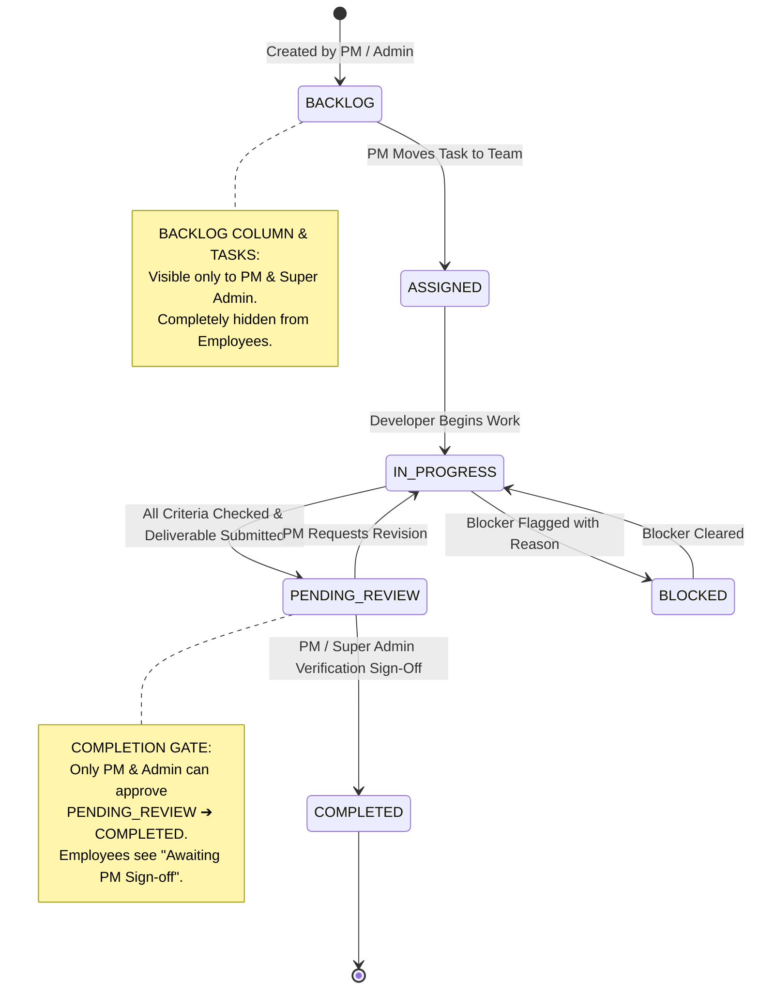
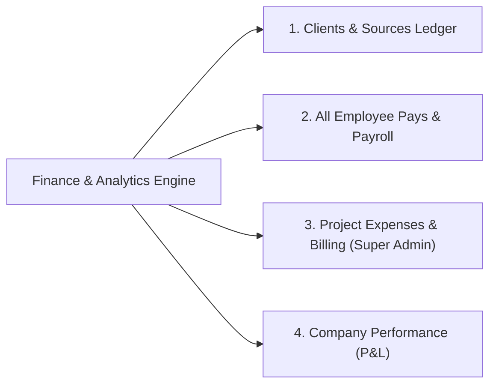
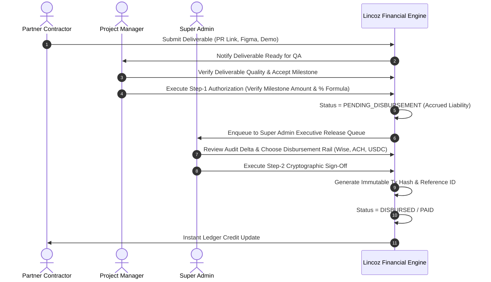
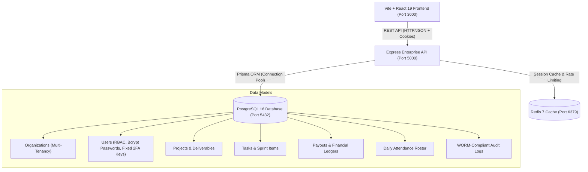

# Lincoz Platform | Software Requirements Specification (SRS) & Product Requirements Document (PRD)

**Document Version:** 2.2.0  
**Status:** Approved & Implemented  
**Classification:** Enterprise Internal  
**Target Environment:** Full-Stack Enterprise (Vite + React 19 + Tailwind CSS + Node.js Express API + PostgreSQL 16 + Redis 7 + Prisma ORM)  
**System Name:** Lincoz Hybrid Project & Financial Management Platform  
**Last Updated:** October 2026  

---

## 1. Executive Summary & Purpose

### 1.1 Purpose
The purpose of this document is to specify the complete functional, technical, security, and non-functional requirements for the **Lincoz Hybrid Project & Financial Management Platform**. The platform is designed to govern both daily project delivery operations and multi-tier financial ledger workflows for organizations operating blended teams composed of:
1. **Full-time Onsite Salaried Employees** (Project Managers, Staff Engineers, UI/UX Designers).
2. **External Percentage-Partner Contractors & Freelancers** (Contract engineers, specialists remunerated via project equity or revenue/milestone shares).
3. **Origination & Referral Sources** (Freelancers and business development partners earning commission based on referred Total Contract Value).
4. **Enterprise Direct Clients** (Corporate accounts with custom commercial contracts and milestone billing).

### 1.2 Core Business Objectives
- **Eliminate Dual-System Overhead**: Consolidate disparate task trackers (e.g., Jira/Trello) and spreadsheet-based financial accounting into a single real-time, unified platform.
- **Strict Data Isolation (Confidentiality Firewall)**: Enforce watertight role-based access control preventing external contractors and unauthorized personnel from viewing confidential client billing rates, company margins, peer compensation, or internal documents.
- **2-Step Cryptographic Financial Governance**: Provide a dual-authorization queue for contractor disbursements (Step-1 PM Deliverable Verification $\rightarrow$ Step-2 Super Admin Cryptographic Sign-Off).
- **Quality Gatekeeping & Separation of Duties**: Restrict task and project completion sign-offs to Project Managers and Super Admins, preventing unverified employee self-completion.
- **Immutable Accountability**: Record all platform mutations in an append-only, WORM-compliant (Write Once, Read Many) audit trail with JSON state diffs.
- **Enterprise Authentication & Fixed 2FA Governance**: Provide exclusive Super Admin control over employee initial credentials, password resets, and fixed two-factor authentication (2FA) security keys with strict sign-in verification.

---

## 2. User Personas & Role-Based Access Control (RBAC)

The system supports four distinct operational personas with granular Row-Level Security (RLS) enforcement.

```mermaid
flowchart TD
    SA["Super Admin (Executive Owner)"] -->|"Full Access"| GL["Global Financial Ledger & 2-Step Sign-Off"]
    SA -->|"Full Access"| PM_MGT["Project, Task & Sprint Governance"]
    SA -->|"Full Access"| UM["User & Client Directory + Password & 2FA Governance"]
    SA -->|"Full Access"| PRD_MGT["Project Requirement Document (PRD) Upload"]
    SA -->|"Full Access"| AUDIT["Global Immutable Audit Log"]

    PM["Project Manager (Onsite)"] -->|"Manage & Complete"| PM_MGT
    PM -->|"Step-1 Verify"| DELIV["Deliverables Review & Task Sign-Off"]
    PM -->|"View & Download"| PRD_VIEW["Project Requirement Document (PRD)"]
    PM -->|"Backlog Governance"| BACKLOG_MGMT["Move Tasks: Backlog ➔ Assigned"]
    PM -->|"Project Completion"| PROJ_COMPLETE["Mark Projects Completed / Active"]
    PM -->|"Delivery Only"| GL_RESTRICTED["Operational Ledger (No Executive Commercials)"]

    OM["Onsite Member (Engineer/Designer)"] -->|"Execute"| TASK_EXEC["Task Execution & Checklist QA"]
    OM -->|"Submit"| DELIV
    OM -.->|"STRICTLY HIDDEN"| BACKLOG_ISOLATED["Backlog Column & Backlog Tasks"]
    OM -.->|"RESTRICTED"| SIGN_OFF_RESTRICTED["Cannot Mark Tasks as Completed"]
    OM -.->|"RESTRICTED"| PRD_HIDDEN["Project Requirement Docs Hidden"]

    PC["Partner Contractor (Freelancer)"] -->|"Data-Isolated"| PORTAL["Contractor Portal"]
    PORTAL -->|"View Only"| OWN_PAY["Own Percentage Ledger"]
    PORTAL -->|"Submit"| DELIV
    PC -.->|"STRICTLY HIDDEN"| BACKLOG_ISOLATED
    PC -.->|"RESTRICTED"| SIGN_OFF_RESTRICTED
    PC -.->|"RESTRICTED"| PRD_HIDDEN
    PC -.->|"STRICTLY MASKED"| CLIENT_FEES["Confidential Client Commercials"]
```



### 2.1 Persona Specifications & Authorization Boundaries

| Role Identifier | Title | Scope of Authority | Data & Action Boundaries |
| :--- | :--- | :--- | :--- |
| `SUPER_ADMIN` | Executive Owner / C-Suite | Global visibility across all entities; CRUD on all projects, tasks, milestones, clients, and users; commercial rate definition; compensation structure configuration; Step-2 payout authorization; financial statement generation; Project Requirement Document (PRD) authoring/upload; employee initial password & fixed 2FA security key provisioning, editing, and overrides; system reset. | None. Unrestricted administrative authority. |
| `PROJECT_MANAGER` | Project Manager (Onsite) | Sprint orchestration; task creation/assignment; milestone lifecycle; blocker escalation/resolution; deliverable QA review; Step-1 contractor calculation verification; task completion sign-off (`PENDING_REVIEW` $\rightarrow$ `COMPLETED`); Backlog management (`BACKLOG` $\rightarrow$ `ASSIGNED`); Project status completion toggle (`ACTIVE` $\leftrightarrow$ `COMPLETED`); PRD view/download access. | **Confidentiality Firewall**: Restricted from executive profit margins, direct expense management, user salary provisioning, and client commercial rate/commission figures in project lists. Cannot change employee passwords. |
| `ONSITE_MEMBER` | Senior / Staff Engineer, Designer | Personal task board; criteria checklist completion; work logging; deliverable link submission; internal task discussion; self-service profile editing (bio, avatar, contact details, skills). | **Backlog Isolation**: Backlog tasks and Backlog column are hidden. **Completion Barrier**: Cannot transition tasks to `COMPLETED` (must submit to `PENDING_REVIEW` for PM sign-off). Cannot view PRD documents, contractor payouts, or financial ledgers. Cannot edit compensation or role fields. |
| `PARTNER` / `CONTRACTOR` | Percentage Partner Contractor | Dedicated contractor portal; deliverable submission (GitHub PRs, Figma links, demo servers); personal milestone payout ledger; self-service profile editing (bio, avatar, contact details, skills). | **Strict Confidentiality Firewall**: Client Total Contract Value (TCV), client hourly/milestone rates, peer payouts, and company financials are masked (`CONFIDENTIAL`). Backlog is hidden. Cannot transition tasks to `COMPLETED`. Cannot view PRD documents. |

---

## 3. Detailed Functional Requirements

### 3.1 Module 1: Project & Milestone Hierarchy

#### 3.1.1 Entity Architecture
The system mandates a four-level hierarchical model:
$$\text{Client Account} \longrightarrow \text{Project} \longrightarrow \text{Milestone Tranches} \longrightarrow \text{Tasks} \longrightarrow \text{Checklist Criteria}$$

#### 3.1.2 Functional Specifications
- **REQ-PRJ-01 (Creation & Metadata)**: Only `SUPER_ADMIN` and `PROJECT_MANAGER` can create projects. Fields include: Project Name, Client Association, Code, Description, Total Contract Value (TCV), Currency, Start Date, Target Delivery Date, Status (`ACTIVE`, `PLANNING`, `ON_HOLD`, `COMPLETED`), Priority (`LOW`, `MEDIUM`, `HIGH`, `CRITICAL`), Assigned Project Manager, and Team Roster.
- **REQ-PRJ-02 (Milestone Definition)**: Each project must have discrete milestone tranches with: Title, Due Date, Billed Milestone Value, Status (`PENDING`, `IN_PROGRESS`, `SUBMITTED`, `VERIFIED`, `PAID`), and Contractor Allocation %.
- **REQ-PRJ-03 (Project Status Aggregation)**: Project completion percentage must be computed dynamically as:
  $$\text{Progress \%} = \frac{\sum \text{Completed Tasks}}{\text{Total Project Tasks}} \times 100$$
- **REQ-PRJ-04 (Project Requirement Document - PRD Specification)**:
  - **Upload Authority**: Super Admin can upload and attach a Project Requirement Document during project creation or via project detail editing.
  - **Validation Constraints**:
    - **Max File Size**: $\le 2\text{MB}$ (strict enforcement with instant error rejection for oversized files).
    - **Allowed File Extensions**: `.pdf`, `.doc`, `.docx`, `.md`, `.zip`.
  - **Data Retention**: Document is stored with dual representation: Base64 data URL (for direct download) and optional external reference URL, along with metadata (`name`, `size`, `uploadedAt`, `notes`).
  - **Access & Visibility Firewall**: Requirement documents are strictly isolated and visible **only to `SUPER_ADMIN` and `PROJECT_MANAGER`**. Requirement document metadata and attachments are systematically stripped from scoped payloads for `ONSITE_MEMBER` and `PARTNER` / Freelance personnel.
- **REQ-PRJ-05 (Project Completion Lifecycle Governance)**:
  - Both `PROJECT_MANAGER` and `SUPER_ADMIN` have direct, one-click authorization to mark an active project as `COMPLETED` (and conversely reopen a completed project to `ACTIVE`).
  - Controls are exposed on:
    1. Project Directory card footers (`ProjectList.jsx`).
    2. Project Details modal banner (`ProjectList.jsx`).
    3. Project Manager executive KPI dashboard (`ProjectManagerDashboard.jsx`).
  - Marking a project completed automatically flags its delivery timestamp, recalculates active portfolio velocity, and logs an immutable audit event (`PROJECT_STATUS_UPDATED`).

---

### 3.2 Module 2: Task Lifecycle & Multi-View Engine

#### 3.2.1 Views Supported
1. **Interactive Kanban Board**: Columnar workflow with real-time drag-and-drop or directional stage transition controls.
2. **Filterable Task List**: Structured tabular grid with multi-attribute filtering (Assignee, Priority, Milestone, Search, Status).
3. **Interactive Gantt / Timeline Roadmap**: Visual horizontal timeline rendering milestone groupings, sprint dates, and completion status.

#### 3.2.2 State Machine & Gatekeeping Flow
Tasks adhere to a strict 5-stage lifecycle state machine with enforced separation of duties:



#### 3.2.3 Functional Specifications
- **REQ-TSK-01 (Checklist Criteria)**: Each task supports granular completion criteria. Checking an item must trigger optimistic UI updates with sub-250ms response times and log an immutable audit event (`ITEM_CHECKED` / `ITEM_UNCHECKED`).
- **REQ-TSK-02 (Blocker Flagging)**: Any assignee can flag a task as `isBlocked = true` with a mandatory reason string. Blocked tasks display high-visibility alerts on PM dashboards and Gantt views.
- **REQ-TSK-03 (Deliverable Attachment)**: Tasks support deliverable asset attachments (GitHub Pull Requests, Figma canvases, staging URLs, release builds) required before transitioning to `PENDING_REVIEW`.
- **REQ-TSK-04 (Backlog Visibility & Assignment Barrier)**:
  - Backlog tasks and the Backlog column are **strictly invisible** to `ONSITE_MEMBER` and `PARTNER`.
  - Non-management employees cannot view, create, or interact with backlog tasks.
  - Only `PROJECT_MANAGER` and `SUPER_ADMIN` can view backlog inventory and execute the transition from `BACKLOG` to `ASSIGNED`.
- **REQ-TSK-05 (Role-Restricted Task Completion & Sign-Off Gate)**:
  - Employees (`ONSITE_MEMBER`, `PARTNER`) are strictly prevented from moving tasks to `COMPLETED`.
  - In the Kanban board and Task Details modal, when a task is in `PENDING_REVIEW`, the advance button is replaced for employees with a prominent badge: **"Awaiting PM Sign-off"**.
  - Only `PROJECT_MANAGER` and `SUPER_ADMIN` possess the authority to verify deliverable quality and approve the final transition from `PENDING_REVIEW` to `COMPLETED`.

---

### 3.3 Module 3: Financial Governance & Multi-Ledger System

The Financial module is partitioned into 4 distinct tabular ledgers accessible via a switcher:



#### 3.3.1 Table 1: Clients & Sources (Freelancers) Ledger
Governs external commercial entities and origination sources, toggleable via view filters:

##### A. Client View (`clientSourceFilter === 'CLIENT'`)
- **Scope**: Direct enterprise corporate accounts hiring the company.
- **Table Columns**:
  1. `Client Name & Contact`: Primary business title, email, phone.
  2. `Category`: Corporate client badge.
  3. `Country & Region`: Geographical location.
  4. `Associated Projects`: Interactive pills linking to active projects.
  5. `Commercial Agreement`: Engagement model (Direct Enterprise Engagement).
  6. `Total Contract Value (TCV)`: Cumulative contractual project value.
- **Constraint**: Payout-related columns (`PAID INWARD`, `PENDING AR`, `PAYMENT STATUS`) are **strictly excluded** from the client table to prevent inappropriate payout categorization of corporate clients.
- **Contextual KPI Strip**:
  - *Total Client Accounts*: Count of enterprise clients.
  - *Client Portfolio TCV*: Aggregate portfolio value.
  - *Active Client Projects*: Total projects under active delivery.
  - *Avg Contract Value*: $\frac{\text{Total Portfolio TCV}}{\text{Total Client Count}}$.

##### B. Source View (`clientSourceFilter === 'SOURCE'`)
- **Scope**: Referral partners and freelance origination sources earning referral commission on contracts.
- **Table Columns**:
  1. `Source / Partner & Contact`: Partner legal identity, contact email.
  2. `Category`: `Source (Freelancer)` badge.
  3. `Country & Region`: Country identifier.
  4. `Referred Projects`: Projects referred into the firm.
  5. `Commission Rate`: Percentage share of TCV (e.g., `10% of TCV`).
  6. `Referred TCV`: Total contract volume generated.
  7. `Total Due`: $\text{Referred TCV} \times \frac{\text{Commission Rate}}{100}$.
  8. `Paid Amount`: Total amount disbursed via recorded payouts.
  9. `Remaining to Pay`: $\max(0, \text{Total Due} - \text{Paid Amount})$.
  10. `Payment Status`: Badges:
      - `Paid` ($\text{Paid Amount} \ge \text{Total Due}$)
      - `Partially Paid` ($\text{Paid Amount} > 0 \land \text{Paid Amount} < \text{Total Due}$)
      - `Unpaid` ($\text{Paid Amount} = 0$)
- **Contextual KPI Strip**:
  - *Total Commission Due*: Aggregate referral fee liabilities.
  - *Paid To Sources*: Cleared referral payouts with percentage cleared indicator.
  - *Remaining To Be Paid*: Outstanding referral fee balance.
  - *Source Status Count*: Pills displaying counts for Paid, Partial, and Unpaid sources.

---

#### 3.3.2 Table 2: All Employee Pays & Payroll Ledger
Governs operational compensation for internal staff and percentage-based contractors.

- **Filter Modes**: `ALL`, `SALARIED` (Onsite staff), `PERCENTAGE` (Equity/Contractor partners), and Status filters (`PAID`, `PARTIALLY_PAID`, `UNPAID`).
- **Salaried Employee Compensation**:
  $$\text{Monthly Salary Due} = \text{round}\left(\frac{\text{Annual Salary}}{12}\right)$$
  - Tracks `Monthly Salary`, `Paid Amount`, `Remaining to Pay`, `Payment Status` (`PAID`, `PARTIALLY_PAID`, `UNPAID`), and payment reference (e.g., `Direct Deposit / Bank ACH`).
- **Percentage Partner Compensation**:
  $$\text{Milestone Payout} = \text{Billed Milestone Amount} \times \left(\frac{\text{Agreement \%}}{100}\right)$$
  - Tracks `Project Share`, `Delivered Scope`, `Total Share Due`, `Paid Amount`, `Remaining Amount`, and `Payment Status`.
- **Sign-off / Disbursement Trigger**: Clicking `Unpaid` or `Partially Paid` prompts the Super Admin with a pre-filled disbursement modal to release funds via Wise, ACH, USDC, or Wire Transfer.

---

#### 3.3.3 Table 3: Project Expenses & Billing (Super Admin Exclusive)
- Project-by-project breakdown of Total Contract Value (TCV), monthly invoiced billing, collections, and pending accounts receivable (AR).
- Project Manager invoice issuance modal generating structured client billing invoices.

---

#### 3.3.4 Table 4: Company Performance & Executive Statements
- Monthly Profit & Loss statement computed as:
  $$\text{Net Monthly Cashflow} = \text{Gross Collections} - (\text{Salaries Disbursed} + \text{Contractor Payouts} + \text{Direct Expenses})$$
- Executive statement printable card with optimized `@media print` stylesheets.

---

### 3.4 Module 4: 2-Step Cryptographic Payout Authorization Workflow

To guarantee financial integrity, partner milestone compensation requires a dual-stage authorization protocol:



---

### 3.5 Module 5: Client & User Directory Management

#### 3.5.1 Client Directory
- CRUD operations on client entities.
- Direct linking between client accounts and project contracts.
- Contact email, phone, location, and billing tier management.

#### 3.5.2 User & Team Directory
- Role assignment (`SUPER_ADMIN`, `PROJECT_MANAGER`, `ONSITE_MEMBER`, `PARTNER`).
- Compensation model configuration:
  - `SALARIED`: Fixed annual base compensation.
  - `PERCENTAGE`: Project equity or milestone revenue share percentage.
- Department tagging (Engineering, Design, Operations, Product).
- Work mode tagging (`ONSITE`, `REMOTE`).

#### 3.5.3 Super Admin Employee Credential & Password Governance (Provisioning & Overrides)
- **REQ-USR-03 (Credential Governance & Password Management)**:
  - **Account Creation Provisioning**: When provisioning any new employee or contractor in `UserManagement.jsx`, `SUPER_ADMIN` directly defines the initial account password with 1-click `Auto-Gen` generation option (`Lincoz#<random-digits>`).
  - **Password Overrides**: Only `SUPER_ADMIN` has the administrative privilege to reset, change, or override passwords for any employee or contractor.
  - **Integrated Management Modals**:
    1. Dedicated Password Reset modal in the Team Directory (`UserManagement.jsx`).
    2. Embedded credential management section in the Edit Profile modal (`EditProfileModal.jsx`).
  - **Validation Constraints**:
    - Minimum length: $\ge 6$ characters.
    - Password confirmation match verification in dedicated modal.
    - Optional "Generate Strong Password" feature producing random, secure alphanumeric credentials.
  - **Authentication Persistence**: Updated passwords persist immediately to the PostgreSQL database (`users.passwordHash` via bcrypt cost 12), reactive context, and local storage. Subsequent sign-ins through `AuthPage.jsx` enforce the newly assigned credentials.

#### 3.5.4 Profile Self-Editing Boundaries
- **REQ-USR-04 (Role-Bounded Profile Editing)**:
  - Users have access to an Edit Profile modal (`EditProfileModal.jsx`) accessible from the header navigation.
  - **Permitted Self-Editable Fields (All Users)**:
    - Profile Photo / Avatar URL.
    - Full Display Name.
    - Contact Email Address.
    - Phone Number.
    - Professional Bio / Summary.
    - Skill Tags (comma-separated).
  - **Restricted Administrative Fields (Super Admin Only)**:
    - User Role (`SUPER_ADMIN`, `PROJECT_MANAGER`, `ONSITE_MEMBER`, `PARTNER`).
    - Account Status (`ACTIVE`, `INACTIVE`, `SUSPENDED`).
    - Base Salary or Milestone Equity Share %.
    - Department & Work Mode provisioning.

#### 3.5.5 Personal To-Do Scratchpad (Employee Private Workspace)
- **REQ-USR-05 (Personal To-Do Decoupling & Privacy)**:
  - Private client-side personal to-do list (`PersonalTodoList.jsx`) scoped exclusively to `currentUser.id`.
  - **Zero Project Relationship**: Items have strictly zero connection to projects, milestones, client accounts, or team deliverables.
  - Features: Priority tags (`Low`, `Medium`, `High`), optional due dates, instant check/uncheck status, filterable tabs (All, Active, Completed), and batch clear completed.
  - Complete data privacy: Personal to-dos are never broadcast to managers or logged in organizational audit reports.

#### 3.5.6 Fixed Two-Factor Authentication (2FA) Security Key Governance
- **REQ-USR-06 (Strict Fixed 2FA Key Enforcement)**:
  - Two-Factor Authentication strictly rejects arbitrary digit inputs or temporary dynamic OTP codes.
  - Every account with 2FA enabled (`isMfaEnabled: true` or role `SUPER_ADMIN`) is bound to a single, fixed, assigned security key (e.g. `8892`, `4419`, `9021`, or custom alphanumeric key like `SEC-4091`).
  - **Sign-In Verification**: At login via `AuthPage.jsx` and the backend `POST /api/auth/login`, entering any non-matching code returns an immediate security error:
    > *"Invalid 2FA Security Key. This key is fixed and can only be set or changed by the Super Admin."*
- **REQ-USR-07 (Super Admin 2FA Provisioning at Account Creation)**:
  - The Provision Employee modal embeds the **"Security & 2FA Credentials Provisioning"** card.
  - Super Admin configures:
    1. **Initial Password** (with show/hide and Auto-Gen).
    2. **Fixed 2FA Key** (with show/hide and 4-digit Auto-Gen).
    3. **Enforce 2FA Toggle**: Checkbox controlling `isMfaEnabled`.
  - Accounts are provisioned and immediately operational with these exact security parameters.
- **REQ-USR-08 (Super Admin Credential & 2FA Editing via Edit Profile Modal)**:
  - When Super Admin clicks "Edit" on any employee card (`EditProfileModal.jsx`), the modal displays the **"Security & 2FA Governance (Super Admin Exclusive)"** card.
  - Super Admin can update the employee's password, modify their fixed 2FA key, and toggle 2FA requirement on/off.
  - Non-Super Admin personnel cannot view, modify, or tamper with credential or 2FA fields.
- **REQ-USR-09 (Dedicated 2FA Management Modal in Team Directory)**:
  - Each employee card in `UserManagement.jsx` displays a dedicated **`2FA Key`** button (emerald `ShieldCheck` icon) for Super Admin.
  - Opens a specialized modal for 1-click 4-digit key generation, key copying, and toggle enforcement with automatic immutable audit event capture (`SECURITY_2FA_UPDATED`).

---

### 3.6 Module 6: Immutable Append-Only Audit Trail (WORM Compliance)

- **Write Once, Read Many (WORM)**: No edit or delete operations are permitted on audit log records.
- **Event Schema**:
  ```typescript
  interface AuditEvent {
    id: string;                 // UUIDv4
    timestamp: string;          // ISO-8601 UTC timestamp
    actorId: string;            // User ID
    actorName: string;          // User display name
    actorRole: Role;            // User role at time of action
    actionType: string;         // e.g., 'PAYOUT_DISBURSED', 'ITEM_CHECKED', 'PASSWORD_CHANGED', 'SECURITY_2FA_UPDATED'
    targetEntity: string;       // e.g., 'TASK', 'MILESTONE', 'PAYOUT', 'USER', 'PROJECT'
    targetId: string;           // Entity UUID
    clientIp: string;           // Recorded IPv4 / IPv6
    userAgent: string;          // Browser / client agent
    previousState: object;      // JSON Snapshot before mutation
    newState: object;           // JSON Snapshot after mutation
  }
  ```
- **Audit Viewer**: Side-by-side JSON state diff inspector accessible to Super Admins.

---

### 3.7 Module 7: Enterprise PostgreSQL 16 & Redis Persistence Architecture (Prisma ORM)

To ensure high-throughput persistence, commercial reliability, and compliance, the platform incorporates an enterprise database architecture:



#### 3.7.1 Functional Specifications
- **REQ-DB-01 (Prisma Multi-Tenant Relational Schema)**:
  - Complete relational schema mapped across 10 discrete models (`organizations`, `users`, `clients`, `projects`, `tasks`, `payouts`, `direct_expenses`, `financial_ledger`, `attendance_records`, `audit_logs`).
  - Strict foreign key constraints and cascade rules ensuring relational integrity.
  - `User` model stores `passwordHash` (bcrypt salt cost 12), `isMfaEnabled`, `mfaKey`, `failedAttempts`, and `lockedUntil`.
- **REQ-DB-02 (Docker Compose Orchestration & Healthchecks)**:
  - Orchestrated via `docker-compose.yml`:
    - `postgres:16-alpine`: Port `5432`, healthcheck (`pg_isready`), persistent volume `pgdata`.
    - `redis:7-alpine`: Port `6379`, healthcheck (`redis-cli ping`), persistent volume `redisdata`.
- **REQ-DB-03 (Authentication Security Hardening & Account Lockout)**:
  - Password hashing utilizing `bcryptjs` with min salt cost factor of 12.
  - Account lockout automatically activated upon 5 consecutive failed login attempts (15-minute lock duration).
  - Short-lived JWT access tokens (15-minute expiry) paired with `httpOnly`, `Secure`, `SameSite=Strict` refresh tokens (7-day expiry).
- **REQ-DB-04 (Atomic Dual-Stage Payout Financial Transactions)**:
  - Step 2 final payout disbursement (`POST /api/financials/payouts/disburse-admin`) executes inside an atomic Prisma transaction (`prisma.$transaction`).
  - Verifies Super Admin cryptographic MFA token, transitions payout state to `DISBURSED`, writes double-entry bookkeeping entry to `financial_ledger`, and records an immutable audit log.
- **REQ-DB-05 (Super Admin 2FA Key Management API)**:
  - Protected endpoint `PATCH /api/users/:id/mfa-key` restricted to `SUPER_ADMIN` role.
  - Updates `mfaKey` and `isMfaEnabled` in PostgreSQL, generating an audit event in `audit_logs`.

---

## 4. Non-Functional Requirements (NFRs)

### 4.1 Performance & Latency
- **Sub-250ms UI Mutation**: All user interactions (checklist checkboxes, status dropdowns, tab switching) must mutate state and update the UI in $< 250\text{ms}$ through optimistic rendering.
- **Bundle Efficiency**: Production build size must be optimized using Vite code-splitting into vendor chunks (React, Lucide icons, date-fns).

### 4.2 Security & Data Privacy
- **Client Rate Concealment**: Under no circumstances shall an external contractor receive or view raw client contract values or hourly bill rates in their API/context payloads.
- **PRD Document Confidentiality**: Requirement documents uploaded by Super Admin must not be leaked to onsite developers or freelance contractors.
- **Separation of QA & Delivery**: Direct completion of tasks is structurally segregated, requiring managerial verification before tasks enter `COMPLETED`.

### 4.3 Reliability & State Recovery
- **Local Persistence**: Workspace state (tasks, users, clients, payouts, audit events) is automatically serialized to browser `localStorage`.
- **Fault-Tolerant Platform Recovery**: An application-level `ErrorBoundary` traps unexpected runtime faults and displays the **Platform State Recovery** dialog, allowing zero-loss state re-initialization.

### 4.4 Typography, Aesthetics & Accessibility
- **Design Tokens**: Premium dark theme palette (`#0B0F17` canvas, `#111827` cards, `#182234` inputs, Slate borders, Emerald/Amber/Indigo accents).
- **Typography**: Google Fonts Inter / Outfit pairing for high clarity.
- **Contrast**: WCAG 2.1 AA compliant text-to-background contrast ratios across all badges, metrics, and data tables.

---

## 5. Technology Stack

| Layer | Technology | Version | Purpose |
| :--- | :--- | :--- | :--- |
| **Frontend Framework** | React | `^19.3.0` | Core UI component hierarchy & reactive state |
| **Bundler & Dev Server** | Vite | `^8.3.1` | Ultra-fast HMR and Rollup-based production builds |
| **Styling** | Tailwind CSS | `^4.3.3` | Utility-first styling & custom CSS design tokens |
| **Icons** | Lucide React | `^1.49.0` | Modern SVG iconography |
| **Date Utilities** | date-fns | `^4.4.0` | Calendar, sprint, and timeline calculations |
| **Micro-Interactions** | canvas-confetti | `^1.9.4` | Milestone, task completion, and payout sign-off celebrations |
| **Backend REST API** | Express.js | `^4.21.2` | Enterprise REST API routes, controllers, and services |
| **Relational Database** | PostgreSQL | `16-alpine` | Multi-tenant ACID relational store on port 5432 |
| **In-Memory Cache** | Redis | `7-alpine` | Fast session store, token invalidation & rate limiting on port 6379 |
| **ORM & Migrations** | Prisma ORM | `^5.22.0` | Type-safe schema definition, relations, migrations & transactions |
| **Password Security** | bcryptjs | `^2.4.3` | Cryptographic password hashing (salt cost factor 12) |
| **Tokens & Auth** | jsonwebtoken | `^9.0.2` | Short-lived access JWTs & secure httpOnly refresh tokens |
| **Containerization** | Docker & Compose | `v2+` | Containerized PostgreSQL 16 & Redis 7 development & production infrastructure |

---

## 6. Directory Structure & File Map

```
d:/Lincoz/project managment tool/
├── docker-compose.yml                       # Docker orchestration for PostgreSQL 16 & Redis 7
├── index.html                               # HTML5 Entrypoint with modern meta & typography
├── package.json                             # Frontend dependencies & build scripts
├── vite.config.js                           # Vite configuration, alias paths & plugins
├── README.md                                # Platform overview, quickstart & credentials guide
├── REQUIREMENTS.md                          # Software Requirements Specification (this document)
├── DEPLOYMENT_CHECKLIST.md                  # Cloud & server deployment verification guide
│
├── server/                                  # Enterprise Node.js / Express Backend (Port 5000)
│   ├── package.json                         # Backend microservice dependencies
│   ├── .env                                 # Database URL, Redis URL, JWT Secrets & Server Port
│   ├── prisma/
│   │   ├── schema.prisma                    # 10-model PostgreSQL schema with relations & indices
│   │   └── seed.js                          # Database seeder with bcrypt hashes & default fixed 2FA keys
│   └── src/
│       ├── index.js                         # Server bootstrap & lifecycle listener
│       ├── server.js                        # Express app configuration, CORS, cookies & helmet
│       ├── config/
│       │   ├── database.js                  # PrismaClient singleton with connection pooling
│       │   └── redis.js                     # Redis client connection & caching helpers
│       ├── infrastructure/
│       │   └── storage/
│       │       └── upload.service.js        # Local disk & S3-compatible file storage driver
│       ├── middleware/
│       │   ├── auth.js                      # JWT bearer verification & user extraction
│       │   ├── rbac.js                      # Strict role authorization middleware
│       │   ├── errorHandler.js              # Centralized JSON error response handler
│       │   ├── validate.js                  # Zod request schema validation middleware
│       │   └── rateLimiter.js               # Redis/memory rate limiting on auth endpoints
│       └── modules/
│           ├── auth/                        # Login, fixed 2FA challenge, refresh token & lockout
│           │   ├── auth.controller.js
│           │   ├── auth.routes.js
│           │   └── auth.service.js
│           ├── users/                       # Staff CRUD, password reset & Super Admin 2FA key management
│           │   ├── users.controller.js
│           │   ├── users.routes.js
│           │   └── users.service.js
│           ├── financials/                  # Invoices, ledgers, and 2-step atomic payout disbursements
│           │   ├── financials.controller.js
│           │   ├── financials.routes.js
│           │   └── financials.service.js
│           ├── projects/                    # Project lifecycle, PRD document upload & isolation
│           │   ├── projects.controller.js
│           │   ├── projects.routes.js
│           │   └── projects.service.js
│           ├── tasks/                       # Task boards, checklist items, blockers & PM sign-off
│           │   ├── tasks.controller.js
│           │   ├── tasks.routes.js
│           │   └── tasks.service.js
│           ├── attendance/                  # Daily roster marking, status summaries & employee self-view
│           │   ├── attendance.controller.js
│           │   ├── attendance.routes.js
│           │   └── attendance.service.js
│           ├── audit/                       # Immutable WORM audit event stream & JSON diff inspection
│           │   ├── audit.controller.js
│           │   ├── audit.routes.js
│           │   └── audit.service.js
│           └── ai-proxy/                    # Enterprise AI endpoint proxy & summarization gateway
│
└── src/                                     # React 19 Frontend Client (Port 3000)
    ├── App.jsx                              # Main routing, layout shell & state provider wrapper
    ├── main.jsx                             # React DOM root mounting
    ├── index.css                            # Tailored design system tokens & clean print media styles
    ├── context/
    │   └── AppContext.jsx                   # Unified reactive store (users, projects, tasks, payouts, audit, auth)
    ├── data/
    │   ├── initialData.js                   # Seed dataset & credentials
    │   └── seedData.js                      # Extended seed records (Alexander, Sarah, Alex, David)
    ├── utils/
    │   └── printDocument.js                 # Window print & document formatting helper
    └── components/
        ├── auth/
        │   ├── AuthPage.jsx                 # Secure login, employee credentials & fixed 2FA verification challenge
        │   └── LandingPage.jsx              # Enterprise product splash page
        ├── layout/
        │   ├── Header.jsx                   # Persona switcher, notifications, profile menu & branding
        │   └── Sidebar.jsx                  # Role-aware navigation drawer
        ├── profile/
        │   └── EditProfileModal.jsx         # User profile self-editing + Super Admin 2FA/Password Governance card
        ├── dashboard/
        │   ├── SuperAdminDashboard.jsx      # Global financials, sign-off queue, KPIs & liability tracking
        │   ├── ProjectManagerDashboard.jsx  # Sprint velocity, blockers, deliverable QA, project completion
        │   └── PartnerDashboard.jsx         # Data-isolated contractor portal
        ├── projects/
        │   ├── ProjectList.jsx              # Project grid, PRD view/download, completion toggle & details
        │   └── CreateProjectModal.jsx       # Project provisioning modal with PRD file attachment
        ├── tasks/
        │   ├── TaskBoard.jsx                # Task board with embedded sprint analysis metrics (Velocity, WIP, QA)
        │   ├── KanbanView.jsx               # Kanban columns, Backlog isolation & PM sign-off gate
        │   ├── GanttView.jsx                # Interactive milestone roadmap
        │   ├── TaskDetailModal.jsx          # Checklist criteria, blocker notes, deliverable links
        │   ├── CreateTaskModal.jsx          # Task authoring modal
        │   └── SubmitDeliverableModal.jsx   # PR / deliverable asset submission modal
        ├── todos/
        │   └── PersonalTodoList.jsx         # Private, decoupled personal to-do scratchpad & checklist
        ├── contractors/
        │   └── AddContractorModal.jsx       # Percentage partner onboarding dialog
        ├── financials/
        │   ├── FinancialsLedger.jsx         # 4-table financial engine (Clients/Sources/Payroll/Expenses)
        │   ├── PayinPayoutManager.jsx       # Milestone invoicing & contractor disbursement
        │   ├── DisbursementModal.jsx        # 2-step disbursement release dialog with MFA validation
        │   ├── ProjectInvoiceModal.jsx      # Client billing invoice generator
        │   └── MonthlyStatementModal.jsx     # Official printable financial P&L statement
        ├── clients/
        │   ├── ClientDirectory.jsx          # Enterprise client directory
        │   ├── AddClientModal.jsx           # Client authoring modal
        │   └── ClientDetailModal.jsx        # Client contract & project inspect modal
        ├── users/
        │   └── UserManagement.jsx           # Staff provisioning, compensation setup, 2FA provisioning & key reset modal
        ├── attendance/
        │   └── AttendanceModule.jsx         # Attendance governance, check-in logging, bulk-marking & employee self-view
        ├── audit/
        │   └── AuditLogViewer.jsx           # Immutable WORM event log & JSON diff viewer
        └── common/
            ├── Badge.jsx                    # Reusable Priority & Status badges
            ├── Modal.jsx                    # Accessible modal wrapper
            ├── StatsCard.jsx                # KPI metric presentation card
            └── ErrorBoundary.jsx            # Crash-prevention & state recovery modal
```

---

## 7. Verification & Acceptance Criteria Matrix

| Req Code | Target Feature | Acceptance Criteria | Verified |
| :--- | :--- | :--- | :---: |
| **AC-01** | **Persona Switching** | Switching personas instantly scopes dashboard views, visible tables, and action permissions without full page reload. | ✅ |
| **AC-02** | **Source Ledger** | In Source view, displays Referred TCV, Total Commission Due, Paid Amount, Remaining to Pay, and accurate Paid/Partial/Unpaid badges. | ✅ |
| **AC-03** | **Client Ledger** | In Client view, displays Client Name, Category, Region, Projects, Agreement, and TCV; excludes payout and inward debt columns. | ✅ |
| **AC-04** | **Employee Payroll** | Salaried and percentage pay records compute remaining balances and render status badges with one-click Super Admin payout actions. | ✅ |
| **AC-05** | **Data Isolation** | Partner contractors cannot view confidential client fees, hourly rates, or other contractors' payouts. | ✅ |
| **AC-06** | **Audit Trail** | All mutations generate immutable, sequential logs with actor identification and before/after JSON diffs. | ✅ |
| **AC-07** | **Print Fidelity** | Official company financial statements format into clean, non-overlapping layouts in desktop mode and clean paper printouts. | ✅ |
| **AC-08** | **PRD Attachment & Isolation** | Super Admin can upload requirement docs ($\le 2\text{MB}$, allowed types `.pdf`, `.doc`, `.docx`, `.md`, `.zip`). Document is visible and downloadable only by Super Admin and Project Manager; strictly stripped/hidden from employees and contractors. | ✅ |
| **AC-09** | **Task Completion Gatekeeping** | Employees (`ONSITE_MEMBER`, `PARTNER`) cannot advance tasks to `COMPLETED`. When in `PENDING_REVIEW`, tasks display "Awaiting PM Sign-off". Only `PROJECT_MANAGER` and `SUPER_ADMIN` can approve completion. | ✅ |
| **AC-10** | **Backlog Visibility & Assignment** | Backlog column and Backlog tasks are completely hidden from `ONSITE_MEMBER` and `PARTNER`. Only `PROJECT_MANAGER` and `SUPER_ADMIN` can view and move tasks from `BACKLOG` to `ASSIGNED`. | ✅ |
| **AC-11** | **Project Completion Control** | Project Managers and Super Admins have one-click controls to mark projects as `COMPLETED` and reopen them to `ACTIVE` across Project Directory cards, Detail modal, and PM Dashboard. | ✅ |
| **AC-12** | **Super Admin Password Management** | Super Admin has exclusive privilege to change employee passwords in User Management with $\ge 6$ character validation; newly set passwords take immediate effect on `AuthPage.jsx`. | ✅ |
| **AC-13** | **Profile Self-Editing Boundaries** | Users can self-edit Photo, Name, Email, Phone, Bio, and Skills via `EditProfileModal.jsx`. Administrative fields (Role, Status, Salary/Percentage) are strictly locked to Super Admin. | ✅ |
| **AC-14** | **Personal To-Do Decoupling** | Employees can maintain private personal to-do scratchpads strictly scoped to their user account with zero connection to projects, deliverables, or administrative oversight. | ✅ |
| **AC-15** | **Staff Attendance Module & Interactive Roster Marking** | Project Managers and Super Admins can mark daily attendance through an interactive full-team roster with colored status rows (Green for Present, Red for Absent, Amber for Leave, Cyan for Half Day), circular `[A] [P] [L] [HD]` toggles, real-time summary statistics, and 1-click roster submission. Employees (`ONSITE_MEMBER`, `PARTNER_FREELANCER`) can strictly only view their own verified attendance logs and hours with zero mutation access or peer visibility. | ✅ |
| **AC-16** | **Fixed 2FA Key Verification & Non-Arbitrary Challenge** | Authentication strictly verifies incoming 2FA challenges against the user's fixed `mfaKey` (default `8892` or customized by Super Admin). Random, arbitrary, or mismatched 4-digit codes are strictly rejected with an explicit invalid-key error message. | ✅ |
| **AC-17** | **Super Admin Account Creation Provisioning** | When Super Admin creates a new team member in `UserManagement.jsx`, the modal includes dedicated "Security & 2FA Credentials Provisioning" controls, providing auto-generation or manual specification of initial password ($\ge 6$ characters) and fixed 4-digit 2FA key. The new user is immediately operable with these credentials. | ✅ |
| **AC-18** | **Super Admin Profile Edit Credential & 2FA Governance** | When Super Admin edits any user via `EditProfileModal.jsx`, a dedicated "Security & 2FA Governance" card is rendered, enabling Super Admin to update the password, view/update the fixed 2FA key, and toggle 2FA requirement on/off. Non-admin users editing their own profile see neither password nor 2FA fields. | ✅ |
| **AC-19** | **Dedicated 2FA Management Action Modal** | User Management provides a dedicated 2FA action button per user row (`ShieldCheck` icon) opening a quick-action modal to toggle 2FA and configure or reassign a fixed 4-digit security key without editing full employee attributes. | ✅ |
| **AC-20** | **Enterprise PostgreSQL 16 & Redis Persistence with Prisma ORM** | All relational models (organizations, users, clients, projects, tasks, payouts, attendance, audit logs) are backed by a production-ready PostgreSQL 16 database managed via Prisma ORM (`schema.prisma`), with bcrypt salt cost 12 password hashing, Redis 7 session/caching, and Docker Compose orchestration. | ✅ |


